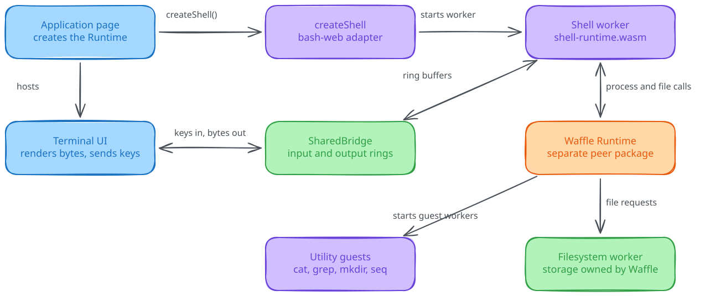

<h1 align="center">bash-web</h1>
<p align="center">A bash-compatible shell for web pages. A Rust engine compiled to WASM, running in a worker on a runtime your page owns.</p>
<p align="center">
  <a href="https://github.com/ShaulLavo/bash-web/actions/workflows/ci.yml"></a>
  <a href="LICENSE"></a>
</p>

> **Experimental and pre-1.0.** Not on npm. Build from source. [Status](#status) lists what works and what does not.

Run a script on the engine, natively, with no browser:

```console
$ shell/target/release/shell-engine -c '
greet() { echo "hello, $1"; }
for name in web wasm; do greet "$name"; done
words=(a b c)
echo "${#words[@]} words, first is ${words[0]}"
printf "%q\n" "two words"
echo $((6 * 7))
seq 3; echo "seq exited $?"
'
hello, web
hello, wasm
3 words, first is a
two\ words
42
seq exited 127
/usr/bin/bash: seq: command not found
```

Run the same engine in a page:

```ts
import { createRuntime } from "waffle";
import { createShell } from "bash-web";

const runtime = createRuntime({
  filesystem: { workerURL: new URL("/fs-worker.js", location.href) },
});
const shell = await createShell({ runtime, script: "echo hello" });
const { code } = await shell.done; // output arrives in shell.terminal
await shell.dispose();
await runtime.dispose();
```

## Why

- **Bash behavior, measured.** GNU Bash 5.3.15 is the oracle. The committed baseline passes 1,315 of 1,682 Oils builtins-only cases (78.2%), comparing stdout bytes and exit status, and CI rejects a change that loses a pass. [Reproduce it](docs/status.md#compatibility-with-bash).
- **Pipelines stream.** Every pipeline stage is a task on one thread, and pipes are bounded. `producer | grep` shows lines as they arrive, and Ctrl+C stops the foreground job without touching background jobs.
- **You pay for the commands you use.** The shell core has no external commands. `cat`, `grep`, `mkdir`, and `seq` are separate WASM programs that you install on demand. Anything not installed exits 127.
- **One runtime per page.** The shell borrows your [Waffle](https://github.com/ShaulLavo/waffle) runtime. It never creates one, and disposing a shell leaves the runtime and other shells alone.

<picture>
  <source media="(prefers-color-scheme: dark)" srcset="docs/assets/architecture.dark.svg">
  
</picture>

The page creates the runtime and `createShell` borrows it. The terminal is two byte rings between the page and the worker.

## Quick start

You need `git` and Rust through [rustup](https://rustup.rs). rustup installs the Rust version in `rust-toolchain.toml`.

1. Clone and build the engine:

   ```sh
   git clone https://github.com/ShaulLavo/bash-web.git
   cd bash-web
   cargo build --release --locked --manifest-path shell/Cargo.toml -p shell-engine --bin shell-engine
   ```

2. Run a script:

   ```sh
   shell/target/release/shell-engine -c 'echo hello; exit 7'; echo "exit: $?"
   ```

   ```text
   hello
   exit: 7
   ```

[Getting started](docs/getting-started.md) continues with pipelines and the utilities. The browser build needs wasi-sdk and more. Start with [Embed a shell in a page](docs/guides/embed-in-a-page.md).

## What you can do

| Task | Where |
| ---- | ----- |
| Build the engine and try scripts | [Getting started](docs/getting-started.md) |
| Run a script or an interactive shell in a page | [Embed a shell in a page](docs/guides/embed-in-a-page.md) |
| Add `cat`, `grep`, `mkdir`, and `seq` | [Install utilities](docs/guides/install-utilities.md) |
| Fix `command not found` or a blank page | [Troubleshooting](docs/troubleshooting.md) |

## How it works

The shell is a WASM program, not a runtime. A thin TypeScript adapter starts it in a worker on the Waffle runtime your page created. The page and the worker share a `SharedArrayBuffer` with an input ring and an output ring, so the page never blocks on the shell. The engine runs one async executor on one thread, and every pipeline stage, subshell, and background job is a task. External commands run as other WASM programs that Waffle starts with the right descriptors. [How bash-web works](docs/concepts/architecture.md) explains the design and [its three ADRs](docs/adr/) record why.

## Docs

[Docs map](docs/README.md) · [Getting started](docs/getting-started.md) · [Guides](docs/guides/embed-in-a-page.md) · [Concepts](docs/concepts/architecture.md) · [API reference](docs/reference/api.md) · [Status and limits](docs/status.md) · [ADRs](docs/adr/) · [Development](docs/development.md)

## Status

Experimental and pre-1.0. The version is `0.0.x`, the package is private, and there are no releases. Any commit can change the API.

| Area | State |
| ---- | ----- |
| Native engine | Builds and tests on macOS arm64 and Linux |
| WASI guests and browser build | Linux only (CI). Not verified on macOS or Windows. |
| Browsers | Chromium and Firefox in CI. Safari is not verified. |
| Bash compatibility | 78.2% of Oils builtins-only cases. Missing: associative arrays, `mapfile`, running traps, printf floats. |
| Bun | Not included. The Bun-specific browser tests are skipped. |

Every gap, with a command that shows it, is in [Status and limits](docs/status.md).

## License

[MIT](LICENSE). The parser and several expansion rules started from [Bashkit](https://github.com/everruns/bashkit) (MIT). See [third-party notices](THIRD_PARTY_NOTICES.md).

## Contributing

Build, test, and layout notes are in [Development](docs/development.md).
