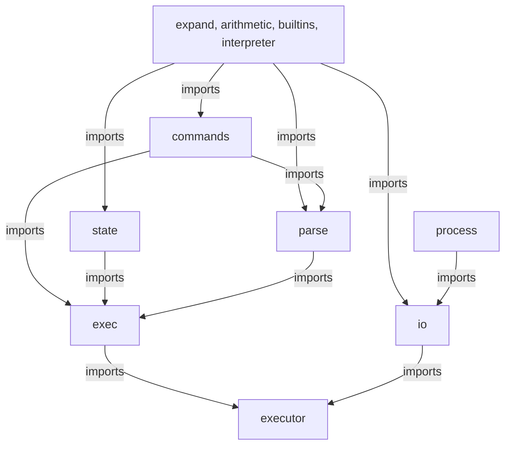

# How bash-web works

bash-web has two halves that meet at one boundary. The shell itself is a Rust program compiled to WASM. A thin TypeScript adapter starts that program in a worker on a runtime the page already owns. This page explains why the pieces sit where they do. For the commands to run it, see [Getting started](../getting-started.md) and [Embed a shell in a page](../guides/embed-in-a-page.md).

<picture>
  <source media="(prefers-color-scheme: dark)" srcset="../assets/architecture.dark.svg">
  
</picture>

Notice that `createShell` never creates the runtime. The page does, and the shell only borrows it.

## The shell is a program, not a runtime

The shell runs as a WASM program under a runtime. It does not contain one. Process, filesystem, pipe, and page lifecycle services belong to the separate [Waffle](https://github.com/ShaulLavo/waffle) package. A page creates one Waffle runtime and passes it to every shell it starts. Closing a shell closes that shell's process and nothing else.

The alternative was a shell package that created its own runtime. It would have been simpler to use and wrong to share: two shells on one page would run two filesystems. See [ADR 001](../adr/001-shell-is-a-wasm-program-on-a-borrowed-runtime.md).

## Three parts: parser, rules, engine

A shell is three things. The parser turns text into a syntax tree. The bash rules say what the tree means: variables, quoting, word splitting, expansions, arithmetic, control flow, traps, and the builtins that change state. The engine decides how commands run: starting processes, moving bytes between pipeline stages, waiting, Ctrl+C, and background jobs.

bash-web's parser (`shell/parser/`, the `shell-parser` crate) started from [Bashkit](https://github.com/everruns/bashkit)'s parser and is now maintained here. The engine and the interpreter's structure are written for single-threaded `wasm32-wasip1` from the start, and Bashkit's rules are ported into that structure one area at a time. The reason is streaming. Bashkit's interpreter assumes scripts run to completion and return their output, so output is collected whole in several places. A pipeline such as `producer | grep` must show each line as it arrives. See [ADR 002](../adr/002-own-engine-instead-of-forking-bashkit.md).

## One thread, many tasks

There is no `fork` in the browser, so the engine does not pretend. It runs one async executor on one thread. Every pipeline stage, subshell, and background job is a task on that executor. File descriptors are a table of reference-counted endpoints. Subshells and pipeline stages share open endpoints, so EOF and broken-pipe behavior follow the last close, as in a real shell. Pipes are bounded and apply backpressure (32 KiB in the standalone harness, 64 KiB in the browser runtime), so a fast producer cannot fill memory. Commands, loops, and expansions check for interruption and yield on a bounded work quantum, which keeps Ctrl+C responsive while WASM is running. [Async shell core](../shell-engine.md) lists the exact contract and bounds.

## Page, worker, and bridge

The shell runs in a worker, because only a worker may block. The page never waits on the shell. The two sides share a `SharedBridge`: a `SharedArrayBuffer` with a 64 KiB input ring, a 256 KiB output ring, and a small control block. The page writes key bytes into the input ring and drains the output ring in bounded tasks triggered by bridge activity. If the page stops draining, the shell's writes block until there is room. That is the backpressure, and it is why the page needs cross-origin isolation.

The terminal UI is a host concern. The bridge carries bytes. The shell guest owns the prompt, history, and line editing. Rendering is up to the page. The demo in `src/browser/` shows one way to do it.

## External commands are other programs

When a script runs `grep`, the shell asks Waffle to start a program, and Waffle starts it in its own worker with the right inherited descriptors, including numbers other than 0, 1, and 2. The shell core ships no external commands. `cat`, `grep`, `mkdir`, and `seq` exist as separate WASM programs that the page installs on demand ([Install utilities](../guides/install-utilities.md)). With nothing installed, the lookup fails with status 127, as in any shell. This keeps the core small and keeps the `regex` crate out of it ([ADR 003](../adr/003-one-core-shell-and-installable-utilities.md)).

## Inside the engine

The engine's Rust modules form layers, and a lower layer never imports a higher one. The four modules at the top are allowed to import one another, because arithmetic and expansion call each other, and builtins and the interpreter do too.

`npm run check:layers` enforces this graph and fails CI when a violation count grows. The graph is `allowedGraph` in `scripts/check-layers.ts`. The diagram leaves out a few allowed edges (the interpreter also imports `process`, for example). For who owns what inside each layer, see [Engine ownership notes](../reference/engine-ownership.md).

## How correctness is measured

GNU Bash 5.3.15 is the oracle. A case passes when stdout bytes and exit status match, and stderr is recorded but not scored. CI compares per-case results against the accumulated current-main passing floor and fails any lost pass. Accepted gains become required without a generated source commit. See [landing checks](../landing-infrastructure.md). [Status](../status.md#compatibility-with-bash) has the current numbers and the command that reproduces them.
